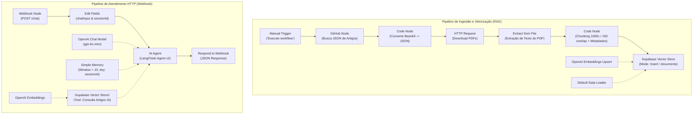

# EA2 — Projeto de RAG e Webhooks (EduBot EA3)

Evolução do Agente de Inteligência Artificial da etapa EA1 para a etapa EA2, incorporando uma base de conhecimento dinâmica utilizando **RAG (Retrieval-Augmented Generation)** com **Supabase pgvector** e disponibilizando o agente como um serviço de backend acessível por **HTTP via Webhook do n8n**.

---

## 📌 Identificação do Projeto

- **Nome do Projeto:** Evolução do Agente de IA com RAG e Webhooks
- **Nome do Agente:** EduBot EA3
- **Autor / Aluno:** Felipe Saliba ([@felipesaliba5-design](https://github.com/felipesaliba5-design))
- **Repositório GitHub do Projeto:** [`EA2-RAG-Webhooks`](https://github.com/felipesaliba5-design/EA2-RAG-Webhooks)
- **Repositório da Base Documental (Artigos):** [`Constru-o-da-Base-Documental-do-Agente-de-IA`](https://github.com/felipesaliba5-design/Constru-o-da-Base-Documental-do-Agente-de-IA)
- **Tecnologias:** n8n, OpenAI (`gpt-4o-mini`, `text-embedding-3-small`), Supabase (`pgvector`), GitHub API, LangChain (n8n Nodes).

---

## 🔗 Links de Acesso e Implementação

1. **Repositório do Projeto no GitHub:**  
   [https://github.com/felipesaliba5-design/EA2-RAG-Webhooks](https://github.com/felipesaliba5-design/EA2-RAG-Webhooks)
2. **Base Documental (JSON de Artigos e Links de PDFs):**  
   [json Agente de IA no GitHub](https://github.com/felipesaliba5-design/Constru-o-da-Base-Documental-do-Agente-de-IA/blob/main/json%20Agente%20de%20IA)  
   [Versão Raw](https://raw.githubusercontent.com/felipesaliba5-design/Constru-o-da-Base-Documental-do-Agente-de-IA/main/json%20Agente%20de%20IA)
3. **Workflow Executável do n8n (JSON):**  
   [`workflow_edubot_rag_webhook.json`](https://github.com/felipesaliba5-design/EA2-RAG-Webhooks/blob/main/workflow_edubot_rag_webhook.json)
4. **Documento Oficial de Entrega (.txt):**  
   [`ENTREGA_EA2_PROJETO_RAG_E_WEBHOOKS.txt`](https://github.com/felipesaliba5-design/EA2-RAG-Webhooks/blob/main/ENTREGA_EA2_PROJETO_RAG_E_WEBHOOKS.txt)

---

## 🏗️ Arquitetura do Sistema

O sistema é dividido em dois pipelines independentes e complementares dentro do n8n:



---

## 📡 Especificação da API HTTP (Webhook)

### Rota e Método
- **Método:** `POST`
- **Caminho de Produção:** `https://<instancia-n8n>/webhook/chat`
- **Caminho de Teste:** `https://<instancia-n8n>/webhook-test/chat`
- **Header:** `Content-Type: application/json`

### Payload de Entrada (Request)
```json
{
  "message": "Qual é a definição de agentes autônomos apresentada nos artigos?",
  "session_id": "usuario_aluno_123"
}
```

### Payload de Saída (Response)
```json
{
  "output": "De acordo com os artigos da base de conhecimento, agentes autônomos são entidades de software baseadas em IA capazes de perceber seu ambiente, tomar decisões deliberativas e executar ações direcionadas a metas..."
}
```

### Exemplo de Chamada (cURL)
```bash
curl -X POST "http://localhost:5678/webhook/chat" \
     -H "Content-Type: application/json" \
     -d '{"message": "O que os artigos abordam sobre agentes de IA?", "session_id": "teste-01"}'
```

---

## 🗄️ Estrutura do Banco de Dados Vetorial (Supabase pgvector)

Consulte o arquivo [`supabase_setup.sql`](./supabase_setup.sql) para o script completo de criação da tabela `documents`, índice HNSW e função RPC `match_documents`.

```sql
CREATE EXTENSION IF NOT EXISTS vector;

CREATE TABLE IF NOT EXISTS documents (
    id BIGSERIAL PRIMARY KEY,
    content TEXT NOT NULL,
    metadata JSONB,
    embedding VECTOR(1536)
);

CREATE INDEX IF NOT EXISTS documents_embedding_hnsw_idx 
ON documents USING hnsw (embedding vector_cosine_ops);
```

---

## 🚀 Como Executar

1. **Configurar o Banco de Dados:** Execute o script `supabase_setup.sql` no SQL Editor do Supabase.
2. **Importar o Workflow no n8n:** Importe o arquivo `workflow_edubot_rag_webhook.json` no n8n.
3. **Vincular Credenciais:**
   - Conta GitHub (leitura de repositórios).
   - Conta OpenAI (acesso ao gpt-4o-mini e embeddings).
   - Conta Supabase (URL e Service Role / API Key).
4. **Executar Ingestão RAG:** Clique em *Execute workflow* no gatilho manual para baixar os PDFs, fatiar e indexar no Supabase.
5. **Ativar o Webhook:** Ligue o interruptor **Active** do workflow no n8n.
6. **Testar Comunicação Externa:** Execute `python test_webhook.py` ou `.\test_webhook.ps1`.
